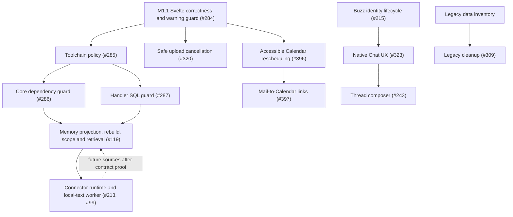

# Elembra Product Maturity Campaign

Audit baseline before M2.3: protected `main` at `d1356743dcf20d3776861c4c1527ede5b37362e6` (M2.2 merge of PR #414). This plan uses current merged behavior and issue updates; it does not authorize deployment, institutional Gate A work, or retained-infrastructure changes.

## Gap matrix

| Issue | Current state | Evidence and remaining scope |
| --- | --- | --- |
| [#196](https://github.com/kubedoio/rustshare/issues/196) | Partially implemented; roadmap epic | The application boundary and bounded Buzz bridge are merged. Connector runtime, Memory completeness, remaining identity UX, and native Chat UX remain separate work. Keep this issue as the campaign tracker, not a rewrite. |
| [#284](https://github.com/kubedoio/rustshare/issues/284) | Unimplemented; old warning count is stale | Frontend CI runs `npm run check` but has no warning budget. Current `main` reports 40 `state_referenced_locally` diagnostics among 76 total Svelte warnings. Fix stale route, application, and query state; add a zero-budget regression guard for this diagnostic. |
| [#285](https://github.com/kubedoio/rustshare/issues/285) | Partially implemented | `rust-toolchain.toml` pins Rust 1.97.1 and Cargo declares MSRV 1.95.0, but workflows and release/build files still contain independent compiler choices. Define build-toolchain versus MSRV policy and add a drift check. |
| [#286](https://github.com/kubedoio/rustshare/issues/286) | In progress (M1.3 first slice) | This PR moves the mailparse-backed EML parser into Infrastructure, leaves its DTOs/errors in Core, and guards against reintroducing mailparse in Core. Core still has other concrete infrastructure dependencies, including SQLx, Reqwest, image, and lettre; extract those only in separately reviewed slices. Server retains mailparse for its separate IMAP header parser. |
| [#287](https://github.com/kubedoio/rustshare/issues/287) | Partially implemented | Repository/service layers exist, while handlers in device-auth, invites, and admin areas still issue SQL directly. Add a guard and migrate handler families incrementally with tenant context preserved. |
| [#320](https://github.com/kubedoio/rustshare/issues/320) | Unimplemented | Upload queues support progress but expose no safe cancellation path. Define abort, server session cleanup, and terminal UI state for single and multi-file uploads. |
| [#396](https://github.com/kubedoio/rustshare/issues/396) | In progress (M2.2) | Add pointer and accessible date/time movement for internal non-recurring timed events in Month, work-week, Day, and Agenda. Preserve event-zone wall time and elapsed duration; provider/imported, recurring, occurrence, and all-day movement stays unsupported. |
| [#397](https://github.com/kubedoio/rustshare/issues/397) | M2.3 implementation in review | Calendar owns a durable reference-only Mail message relation. Both Applications are required and each source is reauthorized on every resolution; event creation is user-confirmed and stores no Mail content. See [the integration contract](../contracts/mail-calendar-integration.md). |
| [#119](https://github.com/kubedoio/rustshare/issues/119) | M3.4 Memory orphan-index cleanup | M3.1–M3.3 provide bounded source reconciliation, AI-independent keyword indexing, and durable resumable recovery. M3.4 adds a separately opt-in, dry-run-first PostgreSQL worker that removes chunks only after rechecking exact tenant/source absence; NULL identities remain unresolved. Files has no legal-hold model, so its retention rules remain enforced at permanent deletion. |
| [#213](https://github.com/kubedoio/rustshare/issues/213) | Unimplemented runtime; contract exists | `connector-contract-v1alpha1.md` and ADR-0037 define a spec-only boundary. Add the common runtime and one local-text worker before broad provider rollout. |
| [#99](https://github.com/kubedoio/rustshare/issues/99) | Unimplemented worker use case | The local-text worker is the first bounded Connector proof. It must use the common contract and cannot write private Files or Memory tables. |
| [#215](https://github.com/kubedoio/rustshare/issues/215) | Partially implemented | Binding proof, client-side encrypted backup, rotation, and offboarding revocation/admin support exist. Remaining work includes pre-bind import, wrong-passphrase throttling, lost-device/list UX, and threat-model/negative-test closure. |
| [#323](https://github.com/kubedoio/rustshare/issues/323) | Partially implemented/reframed | Managed Buzz and Ask/channel authorization exist, but a complete native channel/connections/composer workflow does not. Build on the bridge and preserve Buzz source authority. |
| [#243](https://github.com/kubedoio/rustshare/issues/243) | Unimplemented follow-up | Deliver the thread composer after identity lifecycle and native Chat UX establish channel and principal behavior. |
| [#309](https://github.com/kubedoio/rustshare/issues/309) | Deferred pending inventory | Inventory records and source ownership first; remove legacy code only after the data and compatibility impact is known. |
| [#325](https://github.com/kubedoio/rustshare/issues/325) | Deferred/reframe required | Current Mail is a server-side Application and source. A plugin-owned authoritative copy would conflict with Memory/Connector authority. Revisit client-only/import mode without a second private mail store. |
| [#355](https://github.com/kubedoio/rustshare/issues/355) | Partially implemented | Dark/light preference exists; tenant branding, logos, colors, and admin controls do not. Defer until a separate UX/config contract is approved. |

## Dependency graph

## Small PR sequence and acceptance criteria

Each PR gets independent code/security review and human approval before merge. Security-sensitive PRs include a concise security note. Negative tests below are required alongside the positive acceptance criteria.

| PR | Slice | Measurable acceptance criteria | Required negative tests |
| --- | --- | --- | --- |
| M1.1 | #284 Svelte state correctness | Zero `state_referenced_locally` warnings in frontend `svelte-check`; CI fails if one returns. Route key/id, application/module, and Mail search changes use current values. Editor mode follows the application; attachment reconciliation and late saves/uploads stay scoped to the originating document visit. Login clears cached queries so data from a previous tenant cannot remain visible. Existing layouts and initial form behavior remain unchanged. | App-detail tests reject stale route data, cached-document attachment carryover, and late save/upload/sketch updates after navigation or unmount; same-document saves and unsaved uploads still work. Mail search tests verify current search arguments; auth-store tests verify login clears cached queries across identities. |
| M1.2 | #285 Toolchain/build policy | Document pinned build compiler versus supported MSRV; make Docker, release, and CI choices derive from that policy; a CI check reports no contradictory compiler pins. | A deliberately mismatched workflow/build pin makes the policy check fail. |
| M1.3 | #286 Core dependency inversion guard | The EML parser implementation using mailparse lives in Infrastructure; its DTOs/errors stay in Core, and both Server consumers use the Infrastructure parser. The guard rejects mailparse dependencies/imports in Core. No handler/Core rewrite; remaining concrete Core dependencies are later slices. | Negative manifest and Rust-import fixtures fail the guard; malformed MIME and invalid dates retain their Core error variants; parser and server Mail import tests preserve existing behavior. |
| M1.4+ | #287 Handler SQL by family | Guard SQL construction and execution in handler modules with a documented temporary allowlist; move one handler family per PR into repositories/services with explicit existing scope. Preserve transaction and authorization behavior. First bounded slice: `GET /api/v1/features` delegates the unchanged installation-wide invite workflow lookup to `WorkflowRepository` (see [M1.4 boundary evidence](../architecture/m1.4-feature-workflow-boundary.md)). This slice does not resolve the long-term tenant model. | Cross-workspace identifiers cannot cross existing tenant-scoped boundaries; the feature slice preserves its global lookup. Guard rejects new direct SQL, macro/alias forms, and Executor calls with SQL variables. HTTP DB failures return generic errors. |
| M2.1 | #320 Upload cancellation | Single and multi-file uploads expose cancel; cancellation aborts active work, cleans up or explicitly reports retained server session state, and ends in a terminal canceled state without success toast. | Cancel before start, during transfer, and after completion; canceled work never reports success, and another upload remains unaffected. |
| M2.2 | #396 Calendar rescheduling | Keyboard and pointer rescheduling works at narrow and wide viewports; event wall time and duration are preserved in its timezone across DST transitions; provider/imported events remain read-only. Contract/ADR and OpenAPI stay aligned. | Reject unauthorized edits, read-only event moves, invalid intervals, and DST gap/overlap cases without silently shifting the event. |
| M2.3 | #397 Mail-to-Calendar | A Calendar event can hold a reference to a Mail message; both source endpoints authorize independently at link and open time; contracts and OpenAPI describe reference semantics. | Mail-only access cannot create/read a Calendar link; Calendar-only access cannot resolve the Mail source; revoked access invalidates later opens. |
| M3.1–M3.4 | #119 Memory reliability, split by projection/search/recovery/cleanup | M3.1 adds bounded manual Files reconciliation; M3.2 decouples Notes keyword indexing/search from AI while preserving source reauthorization and indexing policy; M3.3 adds automated, bounded, resumable reconciliation; M3.4 adds a separately leased, cursor-resumable orphan-index sweeper with tenant/source rechecks, dry-run counters, and safe handling for ambiguous IDs. Files remains the sole source authority. Files currently has no legal-hold model; automatic trash purge honors `trash_retention_days`. Broader catalog completeness and scoped retrieval/audit gaps remain. | Hard-deleted source chunks are eventually removed; live and soft-deleted sources and other tenants' chunks survive; ambiguous identity remains unresolved; no stale projection is returned by search/RAG; AI-disabled keyword search and indexing policy continue to work. |
| M4.1 | #215 Identity lifecycle | Complete pre-bind import, throttled wrong-passphrase handling, device listing/recovery, and offboarding revocation with explicit Buzz principal/key binding. Private keys remain client-held. Update identity contract/ADR. | Wrong principal/key, replayed binding proof, revoked/lost device, and repeated bad passphrases cannot bind or recover another principal. |
| M4.2+ | #323 Native Chat UX | Deliver channel/connections UX through the managed bridge, with stable principal binding and Buzz as source authority. Split views/actions into separately reviewable PRs. | Unauthorized channel access, revoked membership, and unbound device cannot load or send messages. |
| M4.3 | #213 Connector runtime + #99 local-text worker | Implement one worker through the common contract, with revocable auth, offline retry, idempotency, and provenance. Do not write directly to Files or Memory private tables. Defer broad cloud providers until this contract is tested. | Duplicate/replayed work is idempotent; revoked credentials and offline failures do not expose or lose source state. |
| M4.4 | #243 Thread composer | Composer supports the approved channel/thread lifecycle after #323 and preserves client-side key custody. | Empty/oversized invalid payloads, unauthorized channel, and revoked device cannot send. |
| M5 | #309 Legacy disposition | Inventory records, code paths, data ownership, and compatibility first; remove only after each retained record has a migration or disposition. | Unknown legacy records are retained/reported; cleanup cannot delete data without a defined disposition. |
| Deferred | #325 Mail mode | Decide a reference/import contract that keeps Mail authoritative and avoids a second private mail database. | Imported references cannot bypass Mail authorization or retain readable content after revocation. |
| Deferred | #355 Branding | Define tenant-scoped branding fields, rendering behavior, and admin permission contract before UX implementation. | One tenant's branding cannot affect another tenant or be changed by a non-admin. |

## M2.2 Calendar rescheduling matrix

The first implementation is limited to internal, writable, non-recurring timed
events. Movement uses the existing owner- and tenant-scoped event PATCH; the
client sends only new UTC `starts_at`/`ends_at` plus the unchanged event IANA
timezone. The event zone resolves local date/time, elapsed duration is retained,
DST gaps are rejected, and overlap wall times choose the earlier instant.
Month/work-week drops translate the browser-calendar day delta to the event's
local date by checking nearby event-zone dates at the preserved wall time and
selecting the date that displays on the requested browser-calendar day. This
also handles cases where the browser and event zones switch daylight time on
different dates.

| View / input | Supported interaction | Limits |
| --- | --- | --- |
| Month | Desktop pointer drag to a highlighted date, followed by confirmation; event details also offers Move. | Date changes preserve event-local start time and elapsed duration. |
| Work week | Desktop pointer drag between weekday columns, followed by confirmation; event details also offers Move. | Monday–Friday columns only; date changes preserve local start time and duration. |
| Day | Event details → Move, with date/time inputs and 15-minute adjustment buttons. | No drag handle over the scrollable hour grid. |
| Agenda | Event details → Move, with date/time inputs and confirmation. | Keyboard and touch use the same controls. |
| Provider/imported | View-only details with source attribution. | No Move action; backend PATCH continues to reject read-only mirrors. |
| Recurring series/occurrence | Existing Edit Series workflow remains available. | Direct movement is disabled; expanded occurrence `instance_start` is never sent as the master's `starts_at`. |
| All-day | Existing date display and exclusive end-date behavior remain. | Movement is disabled until PATCH can preserve `original_date` independently of UTC-midnight instants. |

The API contract is unchanged: it still validates UTC instants and does not
resolve local time. The frontend unit tests cover Europe/Berlin spring gaps and
autumn overlaps, cross-midnight duration, year boundaries, all-day rejection,
and event timezone handling independent of the browser timezone. Focused browser
tests create and remove their own internal event and need no provider OAuth
credentials.

Validation on the M2.2 branch: frontend check (0 errors), lint, all 1,279
Vitest tests, production build, Calendar Rust unit tests (34), PostgreSQL API
tests (28), Calendar Clippy, and OpenAPI export tests (2) passed. The four
focused Playwright cases were collected but skipped locally because admin test
credentials were unavailable; run them in protected CI with the configured
test account. After PR #412 merged, this branch was rebased onto its merge
commit (`085430e36ed6d7b24465af945c09e86d30cabf56`); Rust formatting, Calendar
unit tests (34), and Calendar Clippy passed again. After PR #413 merged, it was
rebased onto latest protected main (`3bb60235bbfbeb5f2b5f50f0fff3cce73084af8f`);
that PR changes only Files upload cancellation, and frontend check, lint, and
all 1,278 Vitest tests passed again. Review then added coverage for imported
Outlook events whose embedded timezone IDs are not accepted by Intl; after
that fix the frontend suite passed all 1,279 tests, check/lint and build passed.
Refreshed protected CI and independent human review are tracked on PR #414.

The PR review loop then found and fixed two additional cases: destination-day
mapping when the browser and event zones enter daylight time on different dates,
and stale move-dialog state after a dropped wall time falls in a DST gap. On the
latest local validation, all 1,283 Vitest tests passed, `npm run check` reported
0 errors (36 existing warnings), lint reported 0 errors (155 existing warnings),
and the production build passed. The four focused Playwright cases were
collected and skipped because local admin credentials are unavailable. Fresh
protected CI and code/security reviews are running for the current PR head.

## Campaign boundaries and validation

M1.2's compiler-resolution inventory, bounded PR #400 `OsRng` fix, and executed
validation are recorded in the [toolchain evidence](../qa/2026-10-23-m1-2-toolchain.md).
The recommended first M1.3 slice is the concrete `mailparse` adapter extraction
into the existing infrastructure crate, retaining Core DTOs and errors.

Deployment, institutional Gate A execution, optional enforced RLS, independent workspace identity, full CalDAV, public plugin marketplace, and autonomous Agent execution are outside this campaign unless separately authorized. Broad cloud Connector providers wait until the common contract and local-text worker are tested.

For each implementation PR, run the smallest relevant checks first, then the applicable full frontend/Rust baseline, PostgreSQL integration tests, Playwright, OpenAPI/contract validation, security checks, and CI. Only report checks actually executed. Changes affecting authorization, tenant visibility, storage, secrets, or source revocation require independent security review and human approval before merge.
